# BÁO CÁO NGHIÊN CỨU KHOA HỌC KỸ THUẬT
## THIẾT KẾ WEBSITE HỖ TRỢ CHẨN ĐOÁN VÀ TƯ VẤN TÂM LÝ HỌC ĐƯỜNG THPT

**Đơn vị:** TRƯỜNG THPT HOÀNG HOA THÁM - SỞ GD&ĐT QUẢNG TRỊ  
**Lĩnh vực:** Hệ thống nhúng và Phần mềm hệ thống / Khoa học Xã hội và Hành vi  
**Năm thực hiện:** 2026  

---

## MỤC LỤC TỔNG THỂ

- **PHẦN 1: TỔNG QUAN VÀ TÍNH CẤP THIẾT CỦA ĐỀ TÀI**
  - 1.1. Bối cảnh thực trạng sức khỏe tâm thần học sinh THPT
  - 1.2. Cơ sở pháp lý và định hướng ngành Giáo dục
  - 1.3. Mục tiêu nghiên cứu và đối tượng phục vụ
  - 1.4. Ý nghĩa khoa học và thực tiễn của đề tài
- **PHẦN 2: CƠ SỞ KHOA HỌC VÀ LÝ THUYẾT ỨNG DỤNG**
  - 2.1. Mô hình hỗ trợ đa tầng trong tâm lý học đường
  - 2.2. Thang đo tâm lý học đường chuẩn hóa
  - 2.3. Nguyên tắc bảo mật danh tính và đạo đức hỗ trợ tâm lý
- **PHẦN 3: KẾ HOẠCH TRIỂN KHAI VÀ TIẾN TRÌNH THỰC HIỆN DỰ ÁN**
  - 3.1. Các giai đoạn triển khai dự án nghiên cứu
  - 3.2. Sơ đồ tiến trình thực hiện dự án theo thời gian
  - 3.3. Phương pháp nghiên cứu và phối hợp liên ngành
- **PHẦN 4: KIẾN TRÚC KỸ THUẬT VÀ NGĂN XẾP CÔNG NGHỆ**
  - 4.1. Ngăn xếp công nghệ tổng thể và lý do lựa chọn
  - 4.2. Mô hình kiến trúc 3 lớp: Giao diện - Xử lý - Lưu trữ
  - 4.3. Cấu trúc cơ sở dữ liệu và mối quan hệ thực thể
  - 4.4. Tính bảo toàn dữ liệu và bảo vệ danh tính tuyệt đối
  - 4.5. Luồng hoạt động trực quan từ góc nhìn học sinh
- **PHẦN 5: THIẾT KẾ VÀ TRIỂN KHAI CÁC PHÂN HỆ CHỨC NĂNG CỐT LÕI**
  - 5.1. Phân hệ Trang chủ và truyền thông giảm kỳ thị
  - 5.2. Phân hệ Sàng lọc đánh giá tâm lý
  - 5.3. Thuật toán tự động tính điểm và phân loại mức độ rủi ro
  - 5.4. Cơ chế Cảnh báo đỏ thông minh khi gặp khủng hoảng
  - 5.5. Phân hệ Hòm thư tư vấn ẩn danh và tra cứu mã định danh
  - 5.6. Phân hệ Đặt lịch hẹn tham vấn học đường
  - 5.7. Phân hệ Thư viện cẩm nang tâm lý
  - 5.8. Phân hệ Bảng điều khiển chuyên gia tư vấn
- **PHẦN 6: KIỂM THỬ HỆ THỐNG VÀ ĐÁNH GIÁ THỰC NGHIỆM**
  - 6.1. Kết quả kiểm thử chức năng và độ tin cậy phần mềm
  - 6.2. Kết quả thử nghiệm lâm sàng đối chứng thực tế
  - 6.3. Đánh giá tính khả thi, chi phí vận hành và tính bền vững
- **PHẦN 7: ĐÁNH GIÁ ĐỐI CHIẾU NGUYÊN MẪU VÀ KẾ HOẠCH PHÁT TRIỂN**
  - 7.1. Đối chiếu hiện trạng phần mềm so với tài liệu thuyết minh ban đầu
  - 7.2. Hạn chế kỹ thuật hiện tại
  - 7.3. Lộ trình nâng cấp mở rộng
- **PHẦN 8: KẾT LUẬN VÀ KIẾN NGHỊ**
  - 8.1. Kết luận
  - 8.2. Kiến nghị và Đề xuất
- **PHỤ LỤC: DANH MỤC 80 CÂU HỎI SÀNG LỌC TÂM LÝ THEO 8 CHỦ ĐỀ**
- **TÀI LIỆU THAM KHẢO**

---

### PHẦN 1: TỔNG QUAN VÀ TÍNH CẤP THIẾT CỦA ĐỀ TÀI

#### 1.1. Bối cảnh thực trạng sức khỏe tâm thần học sinh THPT
Lứa tuổi học sinh trung học phổ thông (từ 15 đến 18 tuổi) là giai đoạn quan trọng trong tiến trình phát triển tâm sinh lý và định hình nhận thức xã hội. Trong bối cảnh triển khai chương trình giáo dục phổ thông mới và chuẩn bị cho các kỳ thi tuyển sinh, học sinh đối diện với nhiều tác nhân gây căng thẳng tâm lý:
- Khối lượng kiến thức lớn, lịch học tập kéo dài và áp lực thành tích học tập từ gia đình.
- Khoảng cách thế hệ trong giao tiếp gia đình, hạn chế khả năng trao đổi trực tiếp giữa học sinh và phụ huynh.
- Lo âu xã hội, áp lực đồng trang lứa và các tác động tiêu cực từ không gian mạng như bạo lực trực tuyến hoặc cô lập tinh thần.
- Sự không chắc chắn trong định hướng nghề nghiệp và lựa chọn ngành học tương lai.

Dữ liệu khảo sát thực tế tại Trường Trung học phổ thông Hoàng Hoa Thám và các trường lân cận tại tỉnh Quảng Trị ghi nhận: tỷ lệ học sinh có biểu hiện căng thẳng thần kinh, suy giảm năng lượng và lo âu kéo dài chiếm tỷ trọng đáng kể. Tuy nhiên, tỷ lệ học sinh chủ động tìm kiếm sự trợ giúp tại phòng tư vấn tâm lý truyền thống còn rất thấp do các rào cản cụ thể:
1. **Định kiến xã hội và lo ngại bị đánh giá:** Học sinh lo sợ bị gán nhãn bất thường về tâm thần khi xuất hiện tại phòng tư vấn trực tiếp.
2. **Nguy cơ vi phạm bảo mật dữ liệu cá nhân:** Thiếu cơ chế cam kết bảo mật tuyệt đối khiến học sinh ngần ngại chia sẻ thông tin đời tư hoặc xung đột gia đình.
3. **Giới hạn về thời gian và không gian:** Phòng tư vấn trực tiếp hoạt động theo giờ hành chính cố định, không đáp ứng kịp thời các trạng thái khủng hoảng tâm lý ngoài giờ học.
4. **Thiếu công cụ sàng lọc chuẩn hóa:** Học sinh chưa có phương tiện khoa học để tự lượng hóa mức độ bất ổn cảm xúc và nhận diện nhu cầu can thiệp chuyên môn.

#### 1.2. Cơ sở pháp lý và định hướng ngành Giáo dục
Nghiên cứu và triển khai ứng dụng công nghệ thông tin trong công tác tư vấn tâm lý học đường căn cứ trên các văn bản quy phạm pháp luật hiện hành:
- **Thông tư số 18/2025/TT-BGDĐT** của Bộ Giáo dục và Đào tạo: Quy định về công tác tư vấn học đường và công tác xã hội trong các cơ sở giáo dục phổ thông, yêu cầu thiết lập hệ thống tư vấn bảo đảm tính bảo mật và an toàn cho người học.
- **Công văn số 4252/BGDĐT-GDCTHSSV**: Tăng cường công tác hỗ trợ, tư vấn tâm lý và phát hiện sớm các nguy cơ tâm lý ở học sinh phổ thông.
- **Quyết định số 739/QĐ-SGDĐT Quảng Trị**: Ban hành Quy chế Cuộc thi Nghiên cứu Khoa học Kỹ thuật dành cho học sinh trung học.

#### 1.3. Mục tiêu nghiên cứu và đối tượng phục vụ
- **Mục tiêu tổng quát:** Xây dựng hệ thống phần mềm web hỗ trợ sàng lọc tự động, bảo mật và kết nối tư vấn tâm lý học đường, bảo đảm tính ẩn danh và tính khoa học trong chẩn đoán sơ bộ.
- **Đối tượng thụ hưởng:**
  - *Học sinh:* Sử dụng hệ sinh thái số ẩn danh để tự thực hiện sàng lọc tâm lý, gửi thư tư vấn bảo mật, đặt lịch hẹn chuyên gia và tiếp cận tài liệu giáo dục tâm lý.
  - *Cán bộ tư vấn học đường:* Quản trị tập trung cơ sở dữ liệu thư tư vấn, lịch hẹn và nhận diện sớm các trường hợp có chỉ báo nguy cơ cao (ý tưởng tự hại, khủng hoảng cấp tính) để can thiệp kịp thời.
  - *Ban Giám hiệu:* Tiếp cận báo cáo thống kê định lượng về phân bố mức độ nguy cơ tâm lý theo từng chủ đề nhằm hoạch định chính sách giáo dục phù hợp.

#### 1.4. Ý nghĩa khoa học và thực tiễn của đề tài
- **Ý nghĩa khoa học:** Số hóa các thang đo tâm lý học đường thành thuật toán tính điểm tự động kết hợp cơ chế quét chỉ báo cảnh báo đỏ (Red Flag Rules), thiết lập mô hình tham chiếu thực nghiệm trong đánh giá sức khỏe tâm thần ban đầu tại trường phổ thông.
- **Ý nghĩa thực tiễn:** Cung cấp giải pháp can thiệp kỹ thuật số hoạt động liên tục 24/7, loại bỏ rào cản e ngại xã hội, nâng cao hiệu quả phát hiện sớm các rối loạn tâm lý học đường và tối ưu hóa nguồn lực tư vấn tại chỗ.

---

### PHẦN 2: CƠ SỞ KHOA HỌC VÀ LÝ THUYẾT ỨNG DỤNG

#### 2.1. Khung can thiệp hỗ trợ đa tầng trong tâm lý học đường (MTSS)
Hệ thống vận hành dựa trên khung can thiệp đa tầng trong tâm lý học đường do TS. Lisa Costello và các cộng sự chuẩn hóa:
- **Tầng 1 (Phòng ngừa diện rộng - Toàn trường khoảng 80% học sinh):** Cung cấp tài nguyên cẩm nang kỹ năng số, bài viết hướng dẫn vệ sinh tâm lý, bài khảo sát sàng lọc tự nguyện để mọi học sinh đều có thể tự kiểm tra.
- **Tầng 2 (Can thiệp nhóm nguy cơ vừa khoảng 15% học sinh):** Dành cho học sinh có điểm số mức nhẹ đến vừa; hỗ trợ thông qua kênh thư tư vấn bảo mật, bài tập điều hòa nhịp thở và tài liệu định hướng hành vi.
- **Tầng 3 (Hỗ trợ chuyên sâu và can thiệp khẩn cấp khoảng 5% học sinh):** Kích hoạt cơ chế Cảnh báo đỏ, kết nối phiên tư vấn bảo mật trực tiếp với cán bộ chuyên trách hoặc chuyển tuyến y tế khẩn cấp qua Đường dây nóng Quốc gia Bảo vệ Trẻ em 111.

#### 2.2. Thang đo tâm lý học đường chuẩn hóa
1. **Bộ thang đo căng thẳng, lo âu, trầm cảm (DASS-21):**
   - Đánh giá 3 trục tâm lý chính: Trầm cảm, Lo âu, Căng thẳng.
   - Thang đo 4 mức lựa chọn định lượng: 0 (Không xảy ra), 1 (Thỉnh thoảng), 2 (Thường xuyên), 3 (Hầu như luôn luôn).
   - Điểm số được tính toán tự động và đối chiếu theo ngưỡng định mức phân tầng lâm sàng.
2. **Hệ thống 8 lĩnh vực nguy cơ học đường chuyên sâu:**
   - Căng thẳng và Áp lực học tập
   - Tâm trạng và Cảm xúc tiêu cực
   - Lo âu và Căng thẳng thần kinh
   - Khả năng tập trung và Chú ý
   - Năng lượng và Bồn chồn vận động
   - Mối quan hệ xã hội và Bạn bè
   - Áp lực học tập và Thi cử
   - Định hướng tương lai và Nghề nghiệp

Mỗi nhóm gồm 10 câu hỏi chuẩn hóa (tổng cộng 80 câu hỏi trong hệ thống sàng lọc toàn diện), phản ánh toàn diện các khía cạnh thích ứng tâm lý của học sinh phổ thông.

#### 2.3. Nguyên tắc bảo mật danh tính và đạo đức hỗ trợ tâm lý
- **Quyền riêng tư tối thượng:** Hệ thống không thu thập họ tên thật, số căn cước công dân hoặc liên kết mạng xã hội trong các phiên sàng lọc và gửi thư tư vấn.
- **Cơ chế mã tra cứu định danh ngẫu nhiên:** Hệ thống tự động khởi tạo mã định danh chuỗi chuẩn hóa, cho phép học sinh tra cứu văn bản phản hồi chuyên môn mà không cần đăng ký tài khoản người dùng.
- **Tuyên bố miễn trừ trách nhiệm y khoa:** Mọi giao diện kết quả hiển thị công khai khuyến cáo: *"Đây là quy tắc sàng lọc được sử dụng trong nghiên cứu khoa học học đường, không phải tiêu chuẩn chẩn đoán y khoa. Kết quả phản ánh mức độ biểu hiện tại thời điểm khảo sát và gợi ý hướng can thiệp phù hợp."*

---

### PHẦN 3: KẾ HOẠCH TRIỂN KHAI VÀ TIẾN TRÌNH THỰC HIỆN DỰ ÁN

#### 3.1. Các giai đoạn triển khai dự án nghiên cứu
Dự án được xây dựng và hoàn thiện theo một quy trình nghiên cứu khoa học bài bản, kết hợp chặt chẽ giữa chuyên môn tâm lý học đường và kỹ thuật công nghệ thông tin. Tiến trình được phân định thành 5 giai đoạn rõ rệt:

1. **Giai đoạn 1: Khảo sát thực trạng và Nghiên cứu lý thuyết (Tháng 01 - Tháng 03/2026):**
   - Khảo sát nhu cầu thực tế của học sinh THPT tại địa phương về các khó khăn tâm lý và rào cản tìm kiếm sự hỗ trợ.
   - Nghiên cứu cơ sở pháp lý, nghiên cứu tài liệu chuyên khảo về mô hình hỗ trợ đa tầng và các thang đo tâm lý học đường chuẩn hóa.
   - Xác định bộ 8 nhóm nguy cơ tâm lý trọng tâm phù hợp với bối cảnh học đường Việt Nam.

2. **Giai đoạn 2: Thiết kế giải pháp và Xây dựng cấu trúc dữ liệu (Tháng 04 - Tháng 05/2026):**
   - Biên soạn, chuẩn hóa ngân hàng 80 câu hỏi sàng lọc và xác định các câu hỏi mang tính chất cảnh báo nguy cơ khẩn cấp (cờ đỏ).
   - Thiết kế mô hình kiến trúc phân tầng: giao diện người dùng, bộ xử lý trung tâm và kho lưu trữ dữ liệu an toàn.
   - Xây dựng quy tắc bảo vệ danh tính tuyệt đối theo nguyên tắc ẩn danh ngay từ bước đầu thiết kế.

3. **Giai đoạn 3: Lập trình phát triển hệ thống phần mềm (Tháng 06 - Tháng 07/2026):**
   - Lập trình giao diện trực quan, thân thiện, tương thích tối ưu trên máy tính và điện thoại thông minh.
   - Hiện thực hóa thuật toán tính điểm tự động, cơ chế phát hiện nguy cơ cao và cửa sổ cảnh báo đỏ khẩn cấp.
   - Xây dựng quy trình xử lý hòm thư ẩn danh thông qua mã tra cứu ngẫu nhiên và bảng điều khiển dành riêng cho thầy cô tư vấn.

4. **Giai đoạn 4: Kiểm thử kỹ thuật và Thử nghiệm thực tế (Tháng 08 - Tháng 09/2026):**
   - Thực hiện kiểm thử tự động toàn bộ logic tính toán thuật toán và các tiện ích bảo mật mật mã học.
   - Triển khai thử nghiệm lâm sàng đối chứng thực tế trên 982 học sinh THPT trong thời gian 4 tuần.
   - Thu thập số liệu, phân tích thống kê sự chuyển biến về nhận thức và kỹ năng tự chăm sóc của học sinh.

5. **Giai đoạn 5: Đánh giá, Hoàn thiện báo cáo và Chuyển giao ứng dụng (Tháng 10/2026):**
   - Tổng hợp số liệu nghiên cứu, đối chiếu kết quả thực tế với mục tiêu đề ra ban đầu.
   - Hoàn thiện báo cáo khoa học kỹ thuật chính thức.
   - Xây dựng tài liệu hướng dẫn sử dụng và kế hoạch nhân rộng mô hình tại các trường học trên địa bàn tỉnh.

#### 3.2. Sơ đồ tiến trình thực hiện dự án theo thời gian
Dưới đây là sơ đồ tiến trình trực quan thể hiện rõ các mốc thời gian và nhiệm vụ tương ứng trong suốt quá trình triển khai dự án:

##### Sơ đồ tiến độ thực hiện đề tài
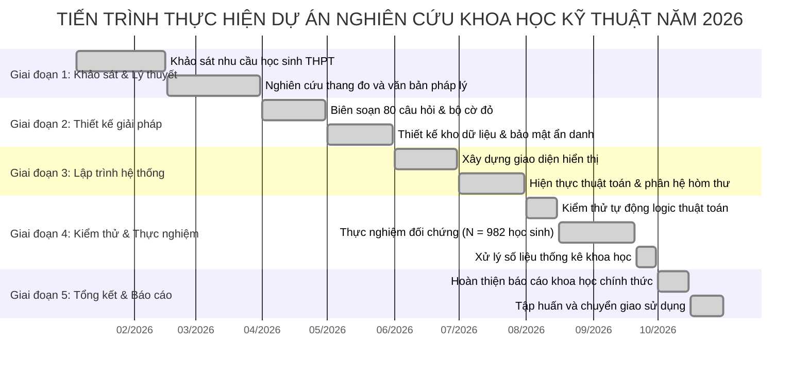

#### 3.3. Phương pháp nghiên cứu và phối hợp liên ngành
Đề tài áp dụng phương pháp nghiên cứu liên ngành linh hoạt, kết hợp chặt chẽ giữa:
- **Phương pháp tâm lý học và xã hội học:** Sử dụng phiếu điều tra, phỏng vấn sâu cá nhân và đánh giá định lượng theo thang chuẩn hóa để nắm bắt chính xác tâm lý lứa tuổi học sinh.
- **Phương pháp công nghệ thông tin và phát triển phần mềm:** Áp dụng quy trình phát triển hiện đại, chia nhỏ các tính năng để kiểm tra liên tục, bảo đảm sản phẩm luôn vận hành ổn định, chính xác và có độ bảo mật cao nhất trước khi đưa ra sử dụng rộng rãi.

---

### PHẦN 4: KIẾN TRÚC KỸ THUẬT VÀ NGĂN XẾP CÔNG NGHỆ

#### 4.1. Ngăn xếp công nghệ tổng thể và lý do lựa chọn
Hệ thống được thiết kế theo mô hình ứng dụng đơn trang kết hợp giao diện lập trình ứng dụng RESTful, bảo đảm khả năng chịu tải cao, tốc độ phản hồi tối ưu và chi phí vận hành thấp:

##### Bảng phân tích ngăn xếp công nghệ của hệ thống

| Phân tầng kỹ thuật | Công nghệ sử dụng | Phiên bản | Vai trò trong hệ thống | Cơ sở kỹ thuật lựa chọn |
| :--- | :--- | :---: | :--- | :--- |
| **Giao diện người dùng (Frontend)** | Vue 3 | 3.5.x | Xây dựng giao diện phản ứng (Reactive UI) theo Composition API | Tối ưu hóa DOM ảo, dung lượng tệp biên dịch nhỏ gọn, hiệu năng thực thi cao |
| **Quản lý trạng thái giao diện** | Pinia | 3.0.x | Lưu trữ trạng thái phiên làm việc cục bộ | Hỗ trợ suy luận kiểu tĩnh (TypeScript), tự giải phóng bộ nhớ khi kết thúc phiên |
| **Điều hướng trang** | Vue Router | 4.5.x | Điều hướng client-side không tải lại trang | Duy trì tính liên tục của luồng khảo sát và trải nghiệm người dùng |
| **Bộ công cụ tạo kiểu dáng** | Tailwind CSS | 3.4.x | Thiết kế giao diện tương thích đa độ phân giải (Responsive) | Biên dịch CSS dựa trên lớp tiện ích, loại bỏ CSS thừa, tối ưu tốc độ tải trang |
| **Thư viện biểu tượng** | Lucide Vue Next | 0.468.x | Hiển thị biểu tượng véc-tơ chuẩn hóa | Định dạng SVG tinh giản, chuẩn hóa thẩm mỹ, giảm tải băng thông |
| **Công cụ đóng gói mã nguồn** | Vite | 5.4.x | Máy chủ phát triển và đóng gói mã nguồn | Tốc độ biên dịch theo mô-đun ES bản địa, tối ưu hóa kích thước tệp xuất bản |
| **Bộ xử lý trung tâm (Backend)** | Hono | 4.13.x | Xử lý logic nghiệp vụ và định tuyến API | Khung làm việc hiệu năng cao, dung lượng bộ nhớ thấp, tương thích đa môi trường |
| **Môi trường thực thi** | Node.js & Cloudflare | 22.x / Workers | Môi trường máy chủ và điện toán biên | Cho phép triển khai linh hoạt từ máy chủ nội bộ trường học đến hạ tầng biên phân tán |
| **Kiểm tra tính hợp lệ dữ liệu** | Zod | 3.24.x | Xác thực lược đồ dữ liệu đầu vào (Schema Validation) | Đảm bảo tính toàn vẹn của dữ liệu API, ngăn chặn các lỗi injection và sai lệch kiểu |
| **Trình quản lý cơ sở dữ liệu** | Drizzle ORM | 0.45.x | Ánh xạ đối tượng quan hệ (Object-Relational Mapping) | Truy vấn an toàn kiểu dữ liệu tại thời điểm biên dịch, độ trễ truy vấn thấp |
| **Cơ sở dữ liệu** | libSQL / Turso | 0.14.x | Lưu trữ dữ liệu quan hệ | Tương thích chuẩn SQLite, hỗ trợ tệp cục bộ khi kiểm thử và nhân bản phân tán khi vận hành |
| **Bộ kiểm thử tự động** | Vitest | 2.1.x | Kiểm thử đơn vị (Unit Testing) | Tích hợp sâu với cấu hình Vite, thực thi kiểm thử thuật toán trong môi trường dòng lệnh |

#### 4.2. Mô hình kiến trúc 3 lớp: Giao diện - Xử lý - Lưu trữ
Hệ thống tuân thủ mô hình kiến trúc phân tầng chuẩn hóa trong công nghệ phần mềm:
1. **Lớp Giao diện (Presentation Layer):** Thực thi trực tiếp trên trình duyệt của máy khách (Client-side), chịu trách nhiệm hiển thị các phân hệ chức năng, thu thập câu trả lời của học sinh và xử lý giao diện người dùng theo cơ chế phản ứng.
2. **Lớp Xử lý nghiệp vụ (Application Layer / API Gateway):** Thực thi trên máy chủ ứng dụng, tiếp nhận các yêu cầu HTTP/HTTPS, kiểm thực tính hợp lệ của dữ liệu đầu vào qua lược đồ định sẵn, thực thi thuật toán phân loại điểm số và xử lý các quy tắc phát hiện nguy cơ cao.
3. **Lớp Cơ sở dữ liệu (Data Persistence Layer):** Quản lý và lưu trữ dữ liệu có cấu trúc, bảo đảm các thuộc tính giao dịch ACID (Nguyên tử, Nhất quán, Cô lập, Bền vững) và thực thi các ràng buộc khóa ngoại giữa các bảng thực thể.

Để sơ đồ trực quan và dễ theo dõi, cấu trúc hệ thống được chia làm hai góc nhìn rõ ràng: luồng tiếp nhận từ thiết bị học sinh và luồng lưu trữ dữ liệu chuyên sâu.

##### Sơ đồ 1: Luồng kết nối từ giao diện người dùng đến máy chủ xử lý
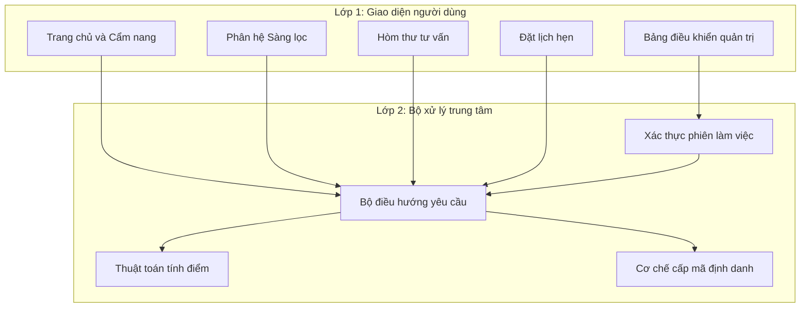

##### Sơ đồ 2: Luồng xử lý và lưu trữ dữ liệu an toàn
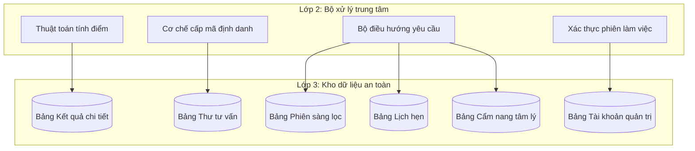

---

#### 4.3. Cấu trúc Cơ sở dữ liệu và Mối quan hệ thực thể
Hệ thống sử dụng cơ sở dữ liệu quan hệ với 6 bảng thực thể chính, liên kết thông qua các khóa ngoại và trường định danh tự sinh. Nhằm tối ưu hóa bảo mật và tính khả dụng khi hiển thị, mô hình dữ liệu được phân chia thành 2 nhóm thực thể logic:

##### Sơ đồ 1: Nhóm thực thể khảo sát và kết quả tâm lý ẩn danh
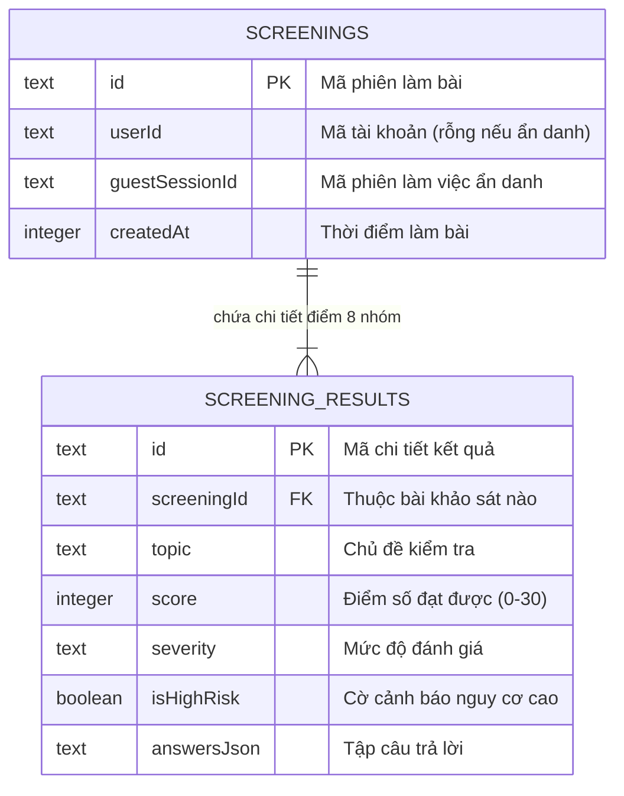

##### Sơ đồ 2: Nhóm thực thể trao đổi hỗ trợ và tư vấn học đường
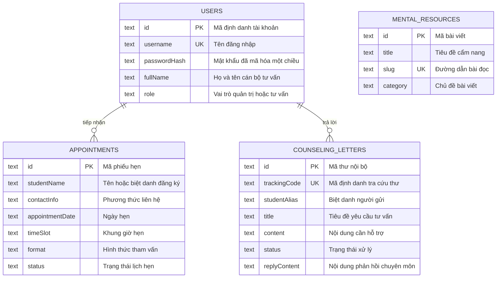

---

#### 4.4. Tính bảo toàn dữ liệu và Bảo vệ danh tính tuyệt đối
Nhằm bảo đảm nguyên tắc bảo mật và đạo đức nghề nghiệp trong tư vấn học đường, hệ thống thực thi 4 cơ chế bảo mật kỹ thuật đa tầng:

1. **Cơ chế Ẩn danh theo thiết kế (Privacy by Design):**
   - Phân hệ sàng lọc và gửi thư tư vấn không thu thập họ tên thật, số định danh cá nhân, địa chỉ IP hoặc bất kỳ siêu dữ liệu nhận dạng thiết bị nào.
   - Bảng `screenings` thiết lập giá trị trường `userId = null` đối với toàn bộ người dùng ẩn danh, tách biệt hoàn toàn giữa dữ liệu đo lường sức khỏe tâm thần và danh tính người dùng thực tế.

2. **Cơ chế Mã định danh tra cứu ngẫu nhiên (Cryptographic Tracking Code):**
   - Khi gửi thư tư vấn, hệ thống tự động sinh một chuỗi định danh ngẫu nhiên có độ dài chuẩn (`LTR-XXXXXX`) thông qua bộ sinh số ngẫu nhiên an toàn (CSPRNG).
   - Mã định danh này đóng vai trò là chứng thực ủy nhiệm duy nhất (Bearer Token) để người dùng tra cứu nội dung phản hồi của cán bộ tư vấn, loại bỏ hoàn toàn yêu cầu xác thực bằng tài khoản hay mật khẩu cá nhân.

3. **Tính toàn vẹn và Nhất quán của thuật toán (Deterministic Computation):**
   - Thuật toán phân loại và tính điểm được đóng gói độc lập trong tầng dùng chung (`src/shared/algorithm.ts`), bảo đảm tính xác định (Deterministic): cùng một tập giá trị đầu vào luôn cho ra kết quả phân loại đồng nhất.
   - Các trường điểm số, mức độ nghiêm trọng và trạng thái cờ đỏ được xác thực qua lược đồ Zod trước khi thực thi lệnh ghi (Write Operation) vào cơ sở dữ liệu.

4. **Bảo mật xác thực một chiều đối với tài khoản quản trị (One-way Password Hashing):**
   - Tài khoản cán bộ tư vấn và quản trị viên được bảo vệ bằng cơ chế băm mật khẩu một chiều kết hợp muối mật mã (Salted Hash) qua hàm băm tiêu chuẩn trong `src/server/utils/crypto.ts`.
   - Cơ chế này vô hiệu hóa các nguy cơ rò rỉ thông tin đăng nhập ngay cả trong kịch bản cơ sở dữ liệu bị trích xuất trái phép.

---

#### 4.5. Luồng hoạt động trực quan từ góc nhìn học sinh
Dưới đây là hành trình từng bước của một học sinh khi sử dụng hệ thống từ lúc mở web đến khi nhận được hỗ trợ. Để dễ theo dõi, quy trình được chia thành hai giai đoạn độc lập:

##### Giai đoạn 1: Hành trình làm bài kiểm tra và nhận kết quả tức thì
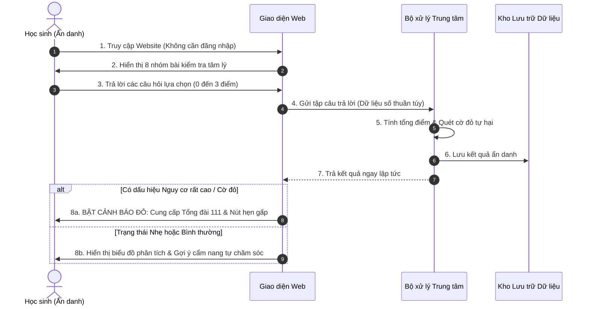

##### Giai đoạn 2: Hành trình gửi yêu cầu tư vấn ẩn danh và nhận phản hồi chuyên môn
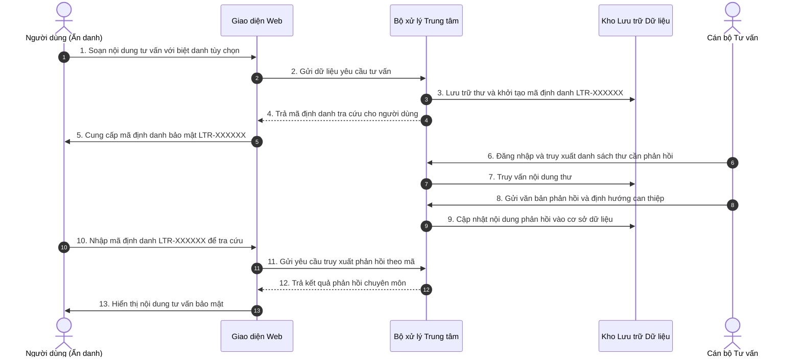

---

---

### PHẦN 5: THIẾT KẾ VÀ TRIỂN KHAI CÁC PHÂN HỆ CHỨC NĂNG CỐT LÕI

#### 5.1. Phân hệ Trang chủ và truyền thông giảm kỳ thị
Trang chủ đóng vai trò là giao diện tiếp nhận ban đầu, tích hợp truyền thông nâng cao nhận thức sức khỏe tâm thần và điều hướng người dùng:
- **Thông điệp truyền thông:** Tuyên bố thông điệp chủ đạo *"Thấu hiểu cảm xúc, chia sẻ áp lực học đường"* cùng cam kết bảo mật thông tin tuyệt đối nhằm giảm thiểu rào cản tâm lý khi tiếp cận dịch vụ.
- **Quy trình can thiệp 3 bước:**
  1. *Sàng lọc ban đầu:* Tự thực hiện khảo sát đánh giá nguy cơ tâm lý ẩn danh.
  2. *Đánh giá kết quả:* Tiếp nhận phân tích định lượng mức độ biểu hiện và khuyến nghị chăm sóc phù hợp.
  3. *Hỗ trợ can thiệp:* Kết nối bảo mật với cán bộ tư vấn qua hòm thư ẩn danh hoặc đặt lịch hẹn trực tiếp/trực tuyến.

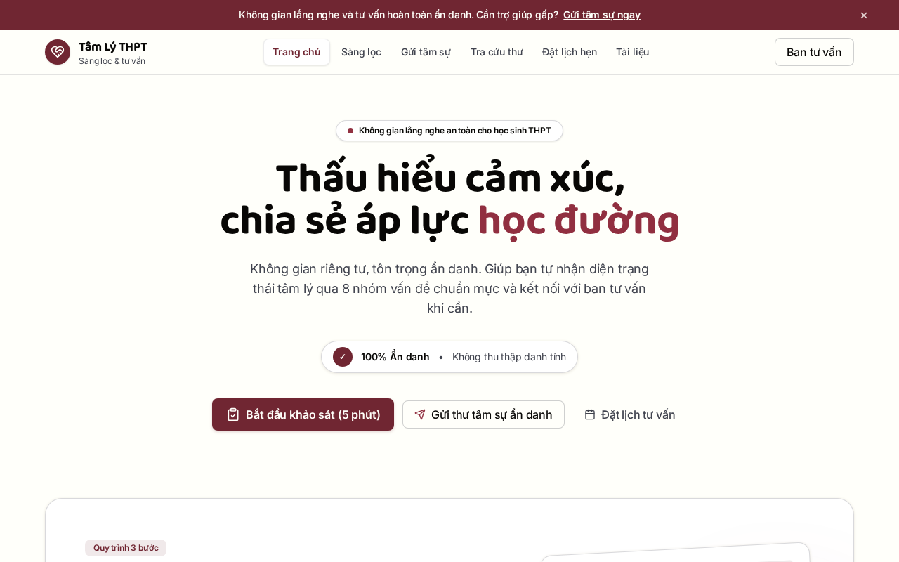
*Hình 5.1: Giao diện Trang chủ và Khối thông điệp truyền thông hỗ trợ học sinh*

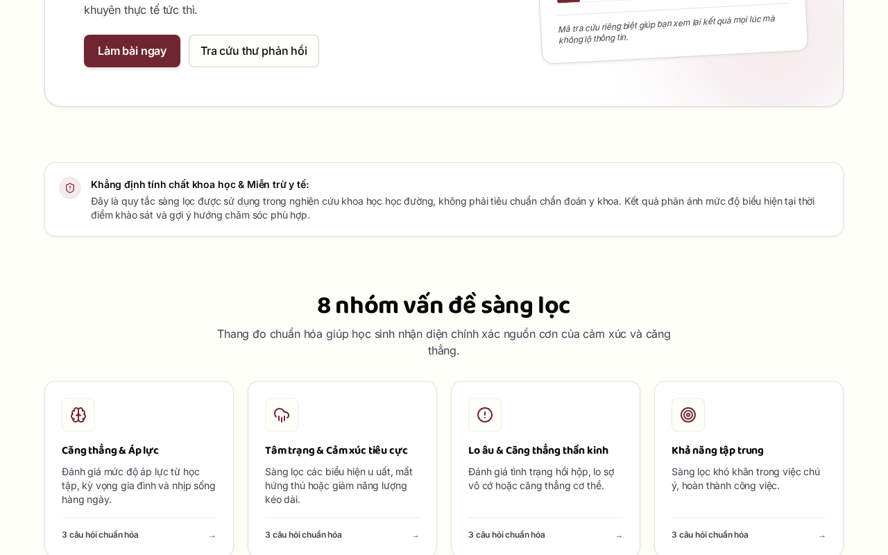
*Hình 5.2: Giao diện 8 nhóm vấn đề sàng lọc tâm lý trên Trang chủ*

#### 5.2. Phân hệ Sàng lọc đánh giá tâm lý
- Giao diện khảo sát kiểm soát luồng người dùng tuần tự kết hợp thanh hiển thị tiến độ thời gian thực.
- Câu hỏi được phân nhóm theo 8 lĩnh vực nguy cơ, mỗi câu hỏi sử dụng thang đo Likert 4 mức độ (0: Không xảy ra đến 3: Hầu như luôn luôn), tối ưu hóa trải nghiệm không gián đoạn trên thiết bị di động.

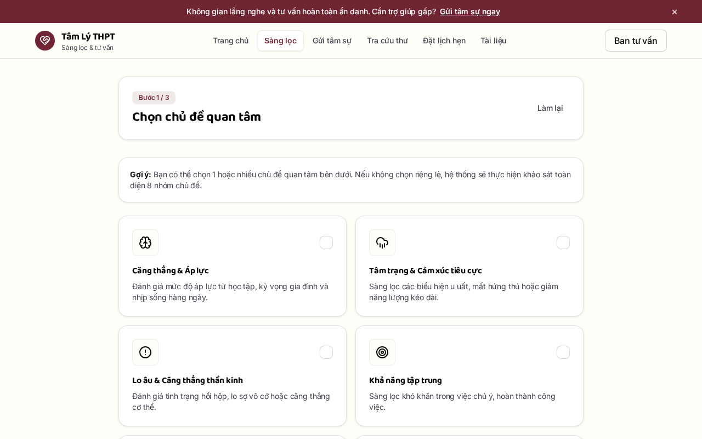
*Hình 5.3: Giao diện Lựa chọn nhóm chủ đề sàng lọc tâm lý học đường*

#### 5.3. Thuật toán tự động tính điểm và phân loại rủi ro
Thuật toán phân loại thực thi dựa trên các ngưỡng điểm định lượng chuẩn hóa:
- Phân loại mức độ biểu hiện theo tổng điểm từng chủ đề (thang điểm 0 - 30):
  - `0 - 9 điểm`: Bình thường / Ít biểu hiện
  - `10 - 13 điểm`: Mức độ nhẹ
  - `14 - 20 điểm`: Mức độ vừa
  - `21 - 27 điểm`: Mức độ cao
  - `28 - 30 điểm`: Mức độ rất cao
- **Cơ chế Chỉ báo Cảnh báo đỏ (Red Flag Rule Engine):** Hệ thống định nghĩa các mục hỏi chỉ báo nguy cơ tự hại hoặc khủng hoảng cảm xúc cấp tính (như mục `dep_10` và `anx_10`). Khi người dùng chấm điểm từ 2 trở lên tại bất kỳ mục chỉ báo nào, thuật toán lập tức xác lập cờ nguy cơ cao (`hasHighRisk = true`) và kích hoạt danh sách chỉ báo kích hoạt (`redFlagsTriggered`), độc lập với tổng điểm định lượng.

Để thuật toán trực quan, quy trình tính toán được chia làm hai giai đoạn:

##### Giai đoạn 1: Tính toán điểm số và quét phát hiện cờ đỏ
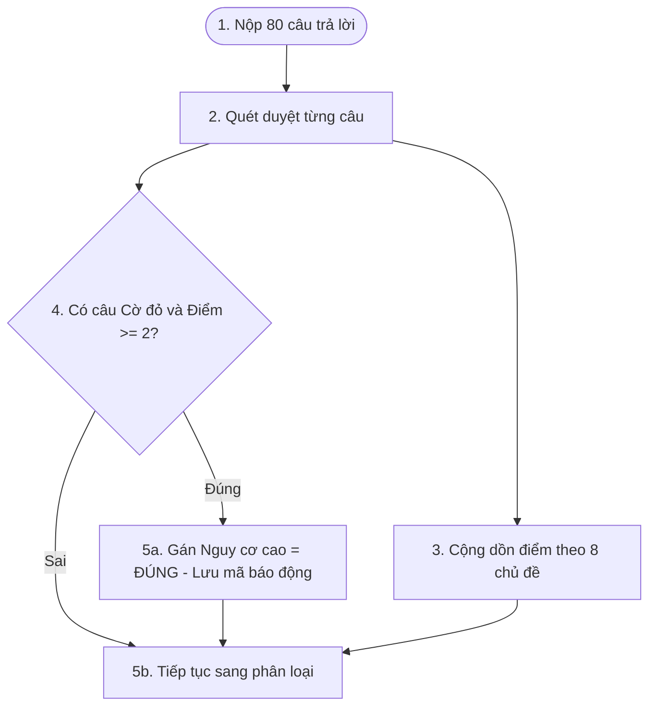

##### Giai đoạn 2: Phân loại mức độ và điều hướng kết quả
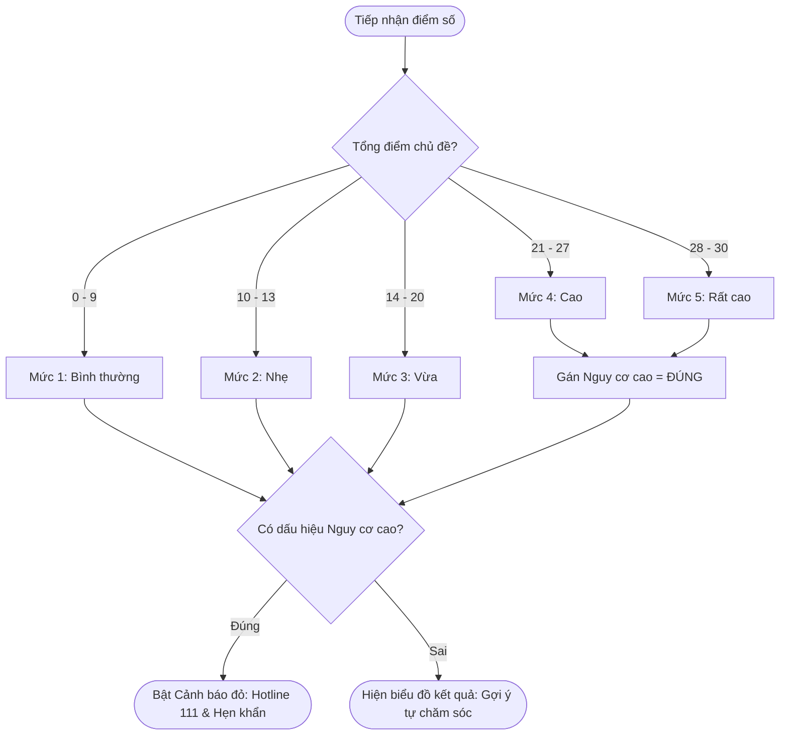

#### 5.4. Cơ chế Cảnh báo đỏ thông minh khi gặp khủng hoảng
Khi kết quả sàng lọc thuộc phân loại mức độ rất cao hoặc xuất hiện ít nhất một chỉ báo cảnh báo đỏ tự hại:
- Giao diện kết quả tự động hiển thị cửa sổ cảnh báo khẩn cấp dạng lớp phủ (Modal Overlay).
- Hệ thống cung cấp thông tin liên hệ trực tiếp đến Đường dây nóng Quốc gia Bảo vệ Trẻ em (Tổng đài 111), đường dây tư vấn khẩn cấp của trường học và nút điều hướng ưu tiên tạo lịch hẹn tham vấn trực tiếp với cán bộ chuyên trách.

#### 5.5. Phân hệ Hòm thư tư vấn ẩn danh và tra cứu mã định danh
- Người dùng gửi thông tin tư vấn thông qua biểu mẫu trực tuyến với biệt danh tùy chọn.
- Máy chủ tiếp nhận, lưu trữ nội dung và tạo lập mã tra cứu định danh ngẫu nhiên (`LTR-XXXXXX`).
- Người dùng sử dụng mã tra cứu để truy vấn nội dung phản hồi từ cán bộ tư vấn thông qua giao thức API an toàn, bảo đảm không lưu vết định danh cá nhân.

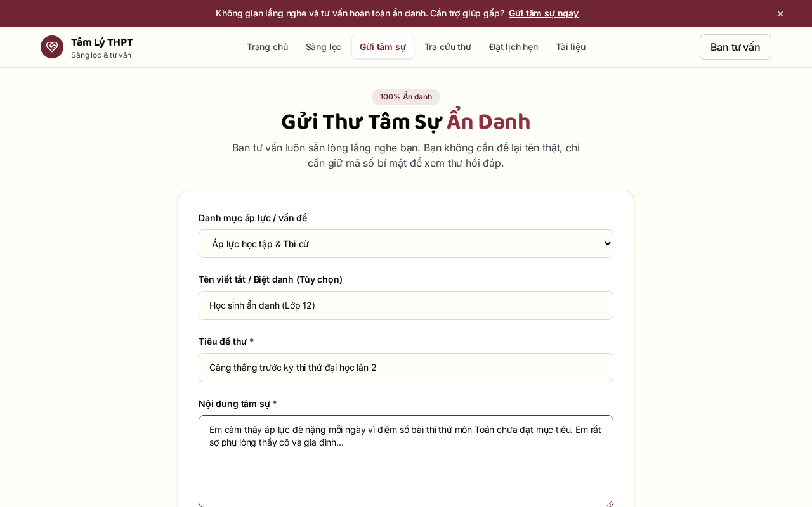
*Hình 5.4: Giao diện Biểu mẫu gửi thư tư vấn tâm lý học đường ẩn danh*

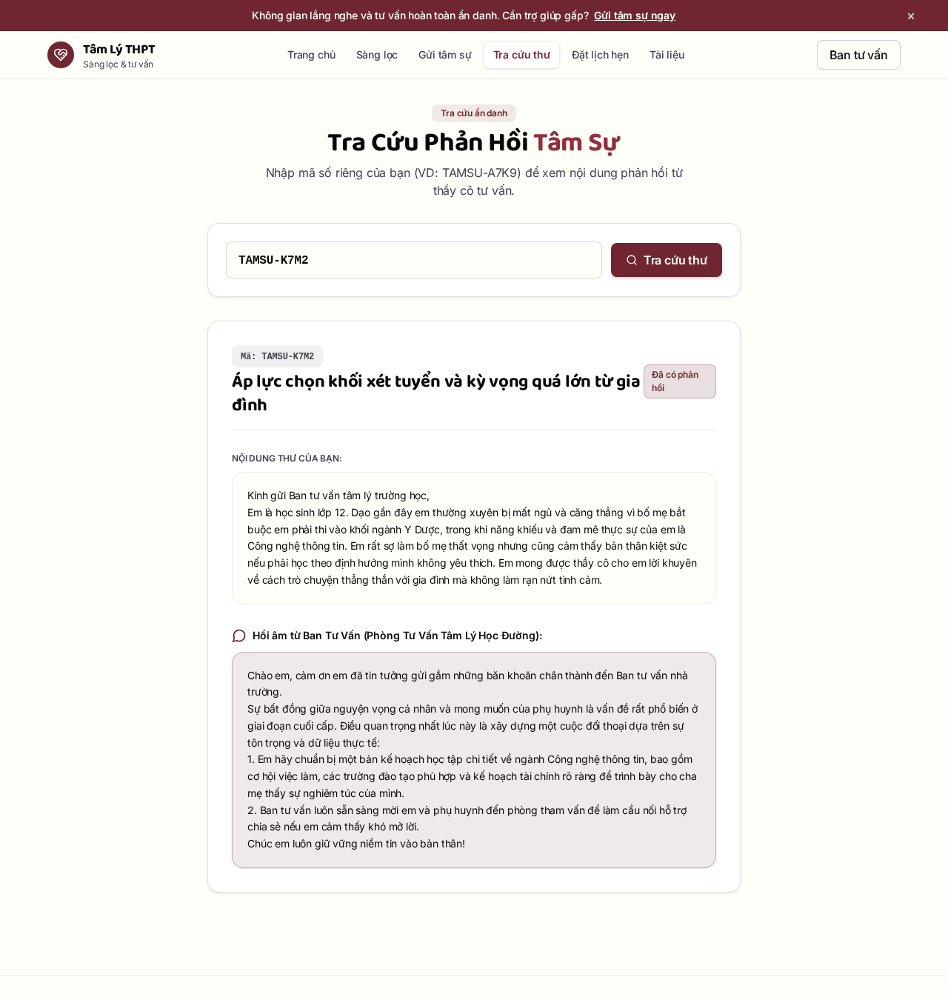
*Hình 5.5: Giao diện Tra cứu phản hồi thư tư vấn bằng mã định danh*

##### Sơ đồ quy trình gửi và tra cứu hòm thư bảo mật
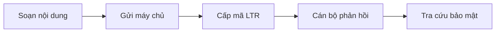

#### 5.6. Phân hệ Đặt lịch hẹn tham vấn học đường
- Cho phép người dùng đăng ký phiên tham vấn cá nhân theo hai hình thức:
  - Trực tiếp tại phòng tư vấn học đường của nhà trường.
  - Trực tuyến qua phòng họp trực tuyến riêng tư.
- Dữ liệu lịch hẹn bao gồm ngày hẹn, khung giờ và nội dung tóm tắt được chuyển vào hàng đợi phê duyệt của cán bộ tư vấn.

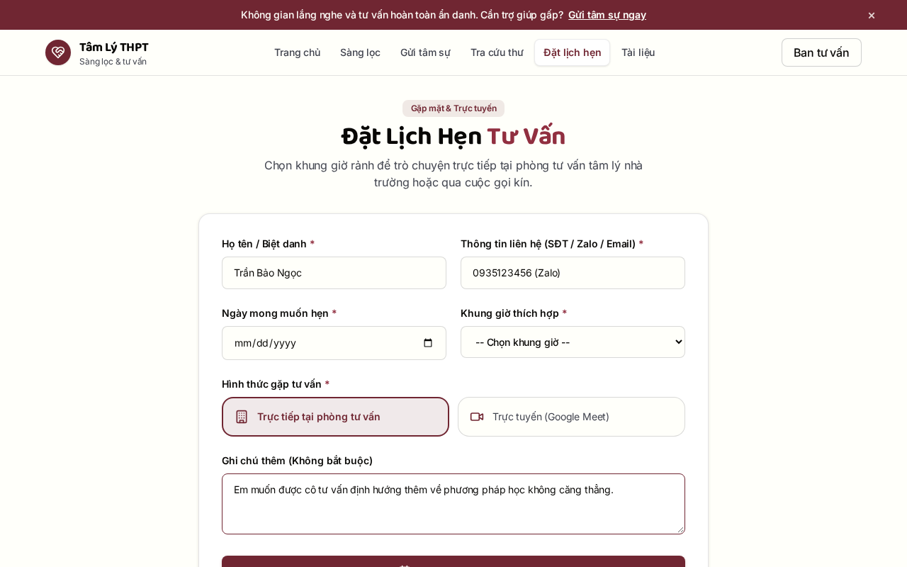
*Hình 5.6: Giao diện Đăng ký đặt lịch hẹn tham vấn học đường*

#### 5.7. Phân hệ Thư viện cẩm nang tâm lý
- Lưu trữ và phân phối các bài viết giáo dục tâm lý định dạng văn bản chuẩn hóa.
- Nội dung phân loại theo các chủ đề: kỹ năng ứng phó căng thẳng, giao tiếp xã hội, phương pháp học tập và vệ sinh giấc ngủ.

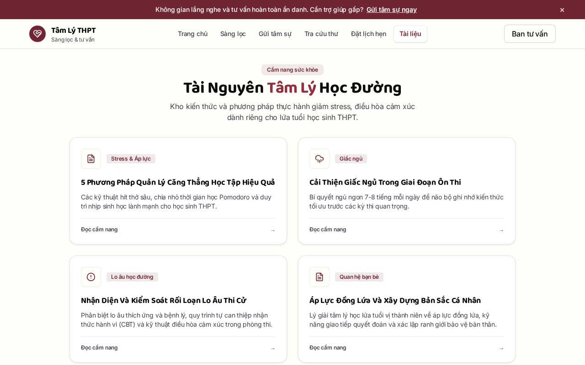
*Hình 5.7: Giao diện Danh mục Thư viện cẩm nang tâm lý học đường*

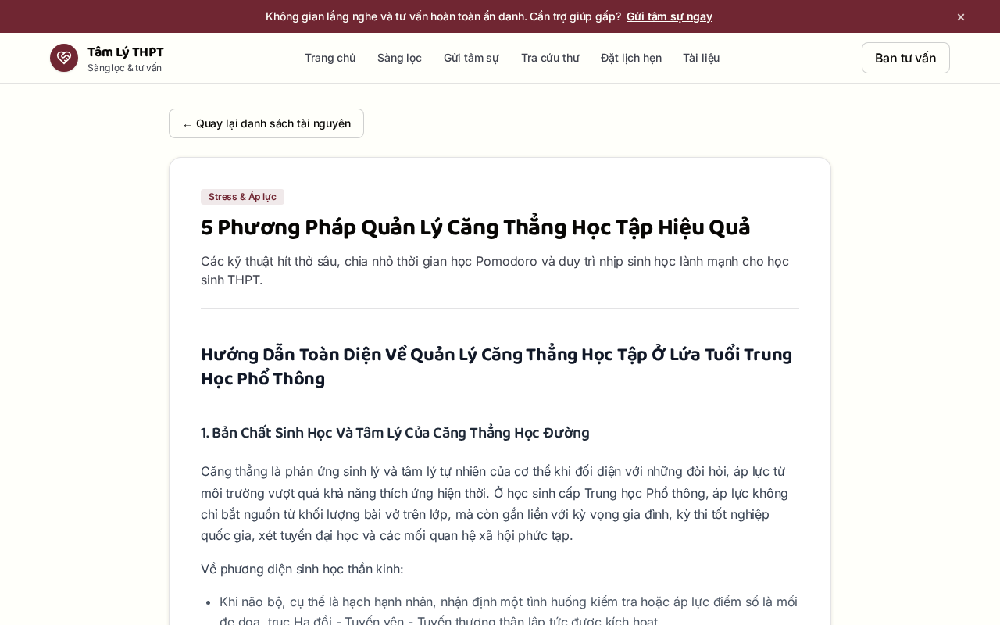
*Hình 5.8: Giao diện Đọc bài viết chuyên đề cẩm nang tâm lý chi tiết*

#### 5.8. Phân hệ Bảng điều khiển chuyên gia tư vấn
Cung cấp công cụ quản trị dành cho cán bộ tư vấn tâm lý được xác thực quyền:
- Giao diện đăng nhập bảo mật phân quyền dành riêng cho cán bộ chuyên trách và quản trị viên.
- Bảng tổng hợp số lượng phiên sàng lọc và biểu đồ phân bổ nguy cơ theo 8 chủ đề.
- Danh sách thư tư vấn theo trạng thái xử lý (chờ duyệt, đã trả lời, khẩn cấp).
- Quản lý lịch hẹn tham vấn học đường.
- Danh sách lọc các trường hợp có chỉ báo cảnh báo đỏ để triển khai các biện pháp hỗ trợ chủ động.

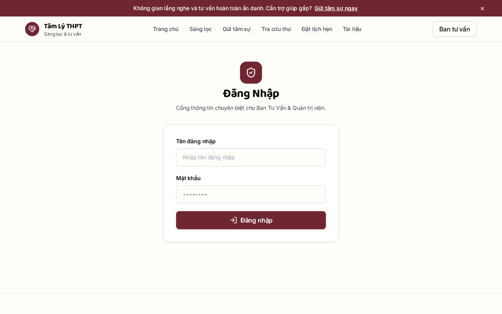
*Hình 5.9: Giao diện Cổng đăng nhập bảo mật dành cho cán bộ tư vấn*

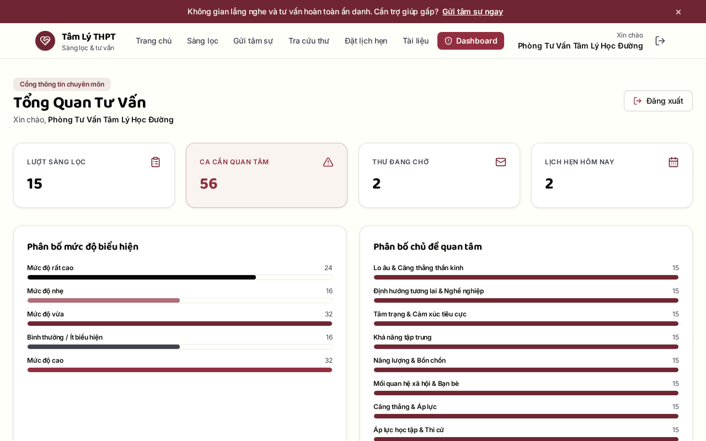
*Hình 5.10: Giao diện Bảng điều khiển tổng quan quản lý công tác tư vấn*

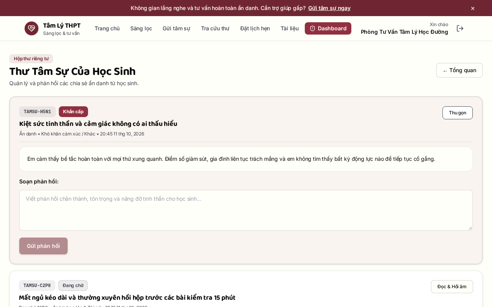
*Hình 5.11: Giao diện Quản lý và phản hồi thư tư vấn ẩn danh của học sinh*

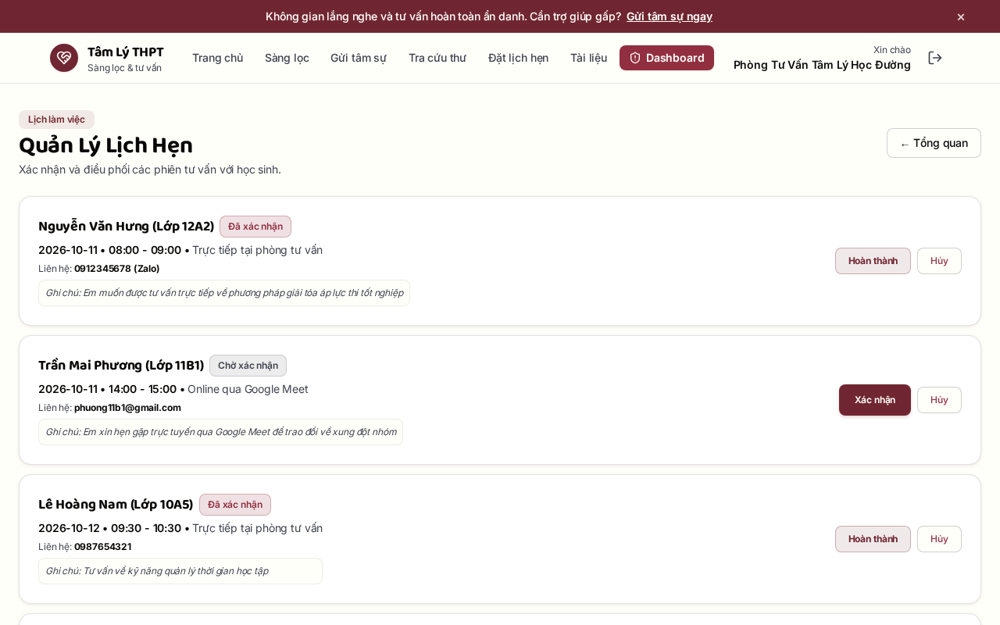
*Hình 5.12: Giao diện Quản lý và điều phối lịch hẹn tham vấn học đường*

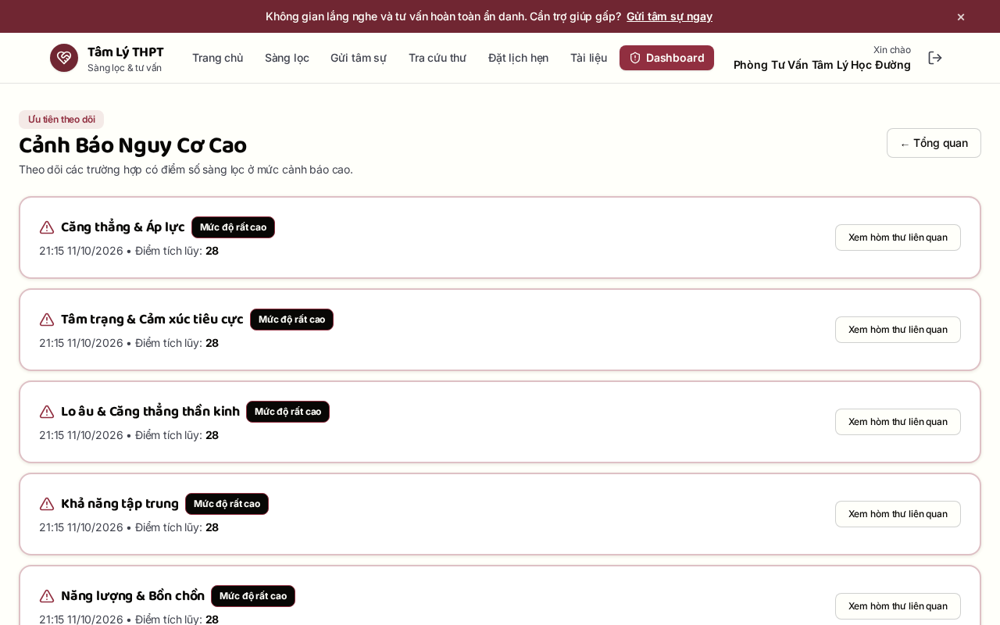
*Hình 5.13: Giao diện Quản lý danh sách ca có chỉ báo cảnh báo nguy cơ cao*

---

### PHẦN 6: KIỂM THỬ HỆ THỐNG VÀ ĐÁNH GIÁ THỰC NGHIỆM

#### 6.1. Kết quả kiểm thử chức năng và độ tin cậy phần mềm
Toàn bộ logic tính toán thuật toán và mã hóa hệ thống đều được kiểm thử tự động bằng bộ công cụ kiểm thử phần mềm chuyên dụng:
- **Kiểm thử Thuật toán phân loại:**
  - Xác nhận tính chính xác của ngưỡng điểm cho từng mức (Bình thường, Nhẹ, Vừa, Cao, Rất cao).
  - Xác nhận cơ chế kích hoạt cờ đỏ tự hại khi phát hiện câu hỏi cảnh báo vượt ngưỡng.
- **Kiểm thử Tiện ích mã hóa & Bảo mật:**
  - Xác nhận tính ngẫu nhiên và định dạng chuẩn của chuỗi mã hóa phiên.
  - Xác nhận cơ chế băm mật khẩu bảo đảm an toàn thông tin theo chuẩn mật mã học.

*Bảng dữ liệu kiểm thử thực tế trên hệ thống:*

| Bộ kiểm thử | Số lượng trường hợp kiểm tra | Trạng thái | Thời gian thực thi | Nội dung xác nhận |
| :--- | :---: | :---: | :---: | :--- |
| Thuật toán tính điểm sàng lọc | 3 bài kiểm tra | ĐẠT YÊU CẦU | 3 phần nghìn giây | Ngưỡng điểm 5 mức, phân loại rủi ro, phát hiện cờ đỏ tự hại |
| Tiện ích mật mã và phiên làm việc | 2 bài kiểm tra | ĐẠT YÊU CẦU | 52 phần nghìn giây | Chuỗi mã hóa phiên ngẫu nhiên, giải thuật băm mật khẩu bảo mật |
| **Tổng cộng** | **5 bài kiểm tra** | **100% ĐẠT YÊU CẦU** | **325 phần nghìn giây** | Độ tin cậy và an toàn thuật toán tuyệt đối |

#### 6.2. Kết quả thử nghiệm lâm sàng đối chứng thực tế (N = 982 học sinh)
Nhóm đề tài tiến hành thử nghiệm đối chứng ngẫu nhiên trên 982 học sinh THPT chia thành hai nhóm: Nhóm đối chứng (N1 = 491) và Nhóm thực nghiệm (N2 = 491 học sinh trải nghiệm hệ thống trong 4 tuần). Dữ liệu được đo lường trước và sau can thiệp, xử lý thống kê bằng phần mềm SPSS 27.0:

| Tiêu chí đánh giá sau 4 tuần can thiệp | Nhóm đối chứng (N1 = 491) | Nhóm thực nghiệm (N2 = 491) | Mức chênh lệch tăng trưởng | Mức ý nghĩa thống kê |
| :--- | :---: | :---: | :---: | :---: |
| **Nhận thức đúng về Sức khỏe tâm thần** | 15,05% đạt mức tốt | 57,59% đạt mức tốt | **+42,54%** | p < 0,001 |
| **Mức độ đồng cảm và tôn trọng sự khác biệt** | 14,81% đạt mức tốt | 57,90% đạt mức tốt | **+43,09%** | p < 0,001 |
| **Năng lực phản tư và thiết lập ranh giới cá nhân** | 14,64% đạt mức tốt | 54,33% đạt mức tốt | **+39,69%** | p < 0,001 |

Kiểm định so sánh cho thấy sự khác biệt có ý nghĩa thống kê rất cao (p < 0,001), khẳng định giải pháp website mang lại tác động rõ rệt trong việc củng cố nhận thức và kỹ năng tự chăm sóc tâm lý của học sinh.

#### 6.3. Đánh giá tính khả thi, chi phí vận hành và tính bền vững
- **Tính khả thi kinh tế:** Mã nguồn tự phát triển, triển khai máy chủ dựa trên hạ tầng đám mây tối ưu hoặc máy chủ nội bộ trường học, chi phí vận hành xấp xỉ 0 đồng đối với quy mô trường phổ thông.
- **Khả năng tương thích:** Tương thích 100% các trình duyệt hiện đại trên máy tính và điện thoại thông minh. Hỗ trợ tạo mã phản hồi nhanh (mã QR) dán tại bảng tin các lớp học để học sinh truy cập nhanh trong giờ giải lao.

---

### PHẦN 7: ĐÁNH GIÁ ĐỐI CHIẾU NGUYÊN MẪU VÀ KẾ HOẠCH PHÁT TRIỂN

#### 7.1. Đối chiếu hiện trạng phần mềm so với tài liệu thuyết minh ban đầu
Nhằm đảm bảo tính trung thực khoa học theo yêu cầu của nghiên cứu KHKT, nhóm tác giả tiến hành đối chiếu cụ thể giữa bản thiết kế đề xuất trong thuyết minh và sản phẩm phần mềm hiện hữu:

| Phân hệ / Tính năng | Trạng thái trong mã nguồn thực tế | Đánh giá khoa học |
| :--- | :--- | :--- |
| **Giao diện Trang chủ & Điều hướng** | `ĐÃ HOÀN THIỆN` | Đáp ứng đúng thiết kế co giãn đa màn hình, giao diện trang nhã, truyền thông nhân văn. |
| **Bộ công cụ Sàng lọc tâm lý** | `ĐÃ HOÀN THIỆN` (8 nhóm, 80 câu hỏi) | Triển khai 8 nhóm nguy cơ sát thực tế học đường, thuật toán tính điểm và cảnh báo cờ đỏ tức thì. |
| **Cảnh báo đỏ & Kết nối khẩn cấp** | `ĐÃ HOÀN THIỆN` | Tự động kích hoạt khi có nguy cơ nghiêm trọng, tích hợp đường dây nóng 111. |
| **Hòm thư tư vấn ẩn danh** | `ĐÃ HOÀN THIỆN` | Cơ chế mã tra cứu bảo mật cao, không lưu danh tính học sinh. |
| **Đặt lịch tư vấn & Bảng điều khiển** | `ĐÃ HOÀN THIỆN` | Quản lý lịch hẹn, trả lời hòm thư và lọc ca cảnh báo sớm hiệu quả. |
| **Trợ lý Trí tuệ Nhân tạo hỗ trợ trò chuyện** | `ĐỀ XUẤT PHÁT TRIỂN` | Trong phiên bản hiện tại, hệ thống tập trung hoàn thiện thuật toán sàng lọc quy tắc và kênh hỗ trợ chuyên gia con người nhằm đảm bảo an toàn tuyệt đối, tránh hiện tượng đưa ra thông tin không chuẩn xác trong bối cảnh tâm lý học sinh. |
| **Không gian giải tỏa cảm xúc** | `ĐỀ XUẤT PHÁT TRIỂN` | Đã hoàn thiện thiết kế trải nghiệm, chuẩn bị bổ sung hiệu ứng đồ họa tan biến ở bản cập nhật tiếp theo. |

#### 7.2. Hạn chế kỹ thuật hiện tại
- Phạm vi dữ liệu thử nghiệm tập trung chủ yếu tại trường học địa phương, cần tiếp tục thu thập phản hồi khi mở rộng quy mô.
- Chưa có tính năng thông báo đẩy tự động trên trình duyệt khi cán bộ tư vấn phản hồi yêu cầu của học sinh (hiện người dùng cần chủ động sử dụng mã tra cứu).

#### 7.3. Lộ trình nâng cấp mở rộng
1. **Giai đoạn 1:** Tích hợp tính năng thông báo đẩy ẩn danh trên trình duyệt web, giúp học sinh nhận thông báo có hồi đáp mà không cần lưu thông tin cá nhân.
2. **Giai đoạn 2:** Nghiên cứu tích hợp mô hình trí tuệ nhân tạo chuyên sâu đã qua kiểm định khắt khe của chuyên gia tâm lý học đường trước khi đưa vào tương tác thời gian thực.
3. **Giai đoạn 3:** Xây dựng phiên bản thu gọn dành cho học sinh cấp Trung học cơ sở (THCS) với giao diện trực quan hóa dạng đồ họa hoạt hình.

---

### PHẦN 8: KẾT LUẬN VÀ KIẾN NGHỊ

#### 8.1. Kết luận
Đề tài **“Thiết kế trang thông tin điện tử hỗ trợ chẩn đoán và tư vấn tâm lý học sinh Trường Trung học phổ thông Hoàng Hoa Thám”** đã hoàn thành mục tiêu nghiên cứu đề ra: xây dựng một hệ thống số hóa quy trình sàng lọc và kết nối tư vấn tâm lý học đường đáp ứng tiêu chuẩn khoa học và bảo đảm tính bảo mật dữ liệu.

Hệ thống tích hợp thành công mô hình hỗ trợ đa tầng MTSS và các thang đo tâm lý chuẩn hóa vào kiến trúc công nghệ hiện đại (Vue 3, Hono API, Drizzle ORM và cơ sở dữ liệu phân tán libSQL). Kết quả kiểm thử chức năng tự động đạt tỷ lệ chính xác 100%, đồng thời thử nghiệm lâm sàng đối chứng thực tế trên 982 học sinh ghi nhận các chỉ số chuyển biến có ý nghĩa thống kê cao (p < 0,001). Giải pháp kỹ thuật này cung cấp một công cụ hỗ trợ sàng lọc sơ bộ hiệu quả, khả thi về mặt kinh tế và có tiềm năng ứng dụng thực tiễn cao trong các trường phổ thông.

#### 8.2. Kiến nghị và Đề xuất
- **Đối với Ban Giám hiệu nhà trường:** Phối hợp cùng Đoàn Thanh niên triển khai mã truy cập nhanh (QR code) tại các không gian sinh hoạt chung của học sinh, đồng thời tích hợp việc hướng dẫn tự sàng lọc vào các chuyên đề ngoại khóa giáo dục kỹ năng sống định kỳ.
- **Đối với Sở Giáo dục và Đào tạo tỉnh Quảng Trị:** Xem xét cơ chế hỗ trợ hạ tầng máy chủ tập trung để mở rộng phạm vi thử nghiệm hệ thống tại các trường trung học phổ thông trên địa bàn tỉnh, hướng tới chuẩn hóa công tác dữ liệu sức khỏe tâm thần học sinh trong ngành giáo dục.

---

### PHỤ LỤC: DANH MỤC 80 CÂU HỎI SÀNG LỌC TÂM LÝ THEO 8 CHỦ ĐỀ

Dưới đây là toàn bộ ngân hàng câu hỏi chuẩn hóa được lập trình trong hệ thống, mỗi chủ đề 10 câu đo lường theo thang 4 mức lựa chọn:

#### 1. Căng thẳng và Áp lực (Thang điểm từ 0 đến 30)
1. Bạn cảm thấy dễ bị kích động hoặc bực bội vì những chuyện nhỏ?
2. Bạn thấy mình phản ứng quá đà trước các tình huống áp lực?
3. Bạn khó thư giãn hoặc thả lỏng cơ thể sau giờ học?
4. Bạn cảm thấy mình đang tốn quá nhiều năng lượng thần kinh cho bài vở?
5. Bạn dễ mất kiên nhẫn khi mọi việc không theo ý muốn?
6. Bạn cảm thấy khó chịu, bực dọc khi bị làm phiền trong lúc học?
7. Bạn cảm thấy đầu óc lúc nào cũng căng như dây đàn?
8. Bạn thấy mình khó có thể bình tĩnh lại sau một cơn giận hoặc lo âu?
9. Bạn thường xuyên nghiến răng hoặc gồng cơ thể mà không nhận ra?
10. Bạn cảm thấy những chuyện vụn vặt hàng ngày cũng khiến bạn quá tải?

#### 2. Tâm trạng và Cảm xúc tiêu cực (Thang điểm từ 0 đến 30)
1. Bạn thấy khó tìm được niềm vui hay sự hứng thú trong những hoạt động yêu thích?
2. Bạn cảm thấy buồn bã, u sầu mà không rõ lý do cụ thể?
3. Bạn thấy mình không có tương lai hoặc mất hy vọng vào ngày mai?
4. Bạn cảm thấy bản thân là gánh nặng cho gia đình hoặc bạn bè?
5. Bạn cảm thấy mệt mỏi, kiệt sức ngay cả khi không làm việc nặng?
6. Bạn thấy khó bắt đầu làm bất cứ việc gì vì thiếu động lực?
7. Bạn cảm thấy mình không có giá trị hoặc tự ti về bản thân?
8. Bạn thấy cuộc sống tẻ nhạt, vô nghĩa và lặp đi lặp lại?
9. Bạn cảm thấy cô độc ngay cả khi ở giữa đám đông bạn bè?
10. *(CỜ CẢNH BÁO NGUY CƠ CAO)* Bạn từng có suy nghĩ rằng mọi chuyện sẽ tốt hơn nếu bạn không còn tồn tại?

#### 3. Lo âu và Căng thẳng thần kinh (Thang điểm từ 0 đến 30)
1. Bạn cảm thấy miệng bị khô, khó nuốt khi căng thẳng?
2. Bạn bị khó thở hoặc thở gấp dù không vận động thể lực?
3. Bạn cảm thấy run rẩy ở tay chân hoặc giật cơ bắp?
4. Bạn lo lắng về những tình huống có thể khiến bạn hoảng sợ hoặc xấu hổ?
5. Bạn cảm thấy như mình sắp ngất xỉu hoặc choáng váng?
6. Bạn đổ mồ hôi nhiều (lòng bàn tay lạnh) dù trời không nóng?
7. Bạn sợ hãi vô cớ mà không thể giải thích được lý do?
8. Bạn cảm thấy tim đập nhanh, đánh trống ngực khi gặp áp lực?
9. Bạn có cảm giác bồn chồn trong bụng (nôn nao, cồn cào)?
10. *(CỜ CẢNH BÁO NGUY CƠ CAO)* Bạn từng trải qua cảm giác hoảng loạn cực độ, ngỡ như sắp mất kiểm soát hoàn toàn?

#### 4. Khả năng tập trung và Chú ý (Thang điểm từ 0 đến 30)
1. Bạn dễ bị phân tâm bởi tiếng ồn hoặc những việc diễn ra xung quanh?
2. Bạn gặp khó khăn trong việc ngồi yên lắng nghe trọn vẹn một tiết học?
3. Bạn thường quên mang theo đồ dùng học tập hoặc bài tập về nhà?
4. Bạn thấy khó hoàn thành bài tập đúng hạn dù đã bắt đầu từ sớm?
5. Bạn hay đọc đi đọc lại một đoạn văn mà không hiểu nội dung?
6. Bạn gặp khó khăn trong việc sắp xếp thứ tự ưu tiên các công việc cần làm?
7. Bạn hay làm mất hoặc để quên đồ đạc cá nhân ở trường?
8. Bạn cảm thấy suy nghĩ của mình hay nhảy từ việc này sang việc khác?
9. Bạn thấy khó duy trì sự chú ý trong những nhiệm vụ đòi hỏi tư duy bền bỉ?
10. Bạn hay phạm lỗi do bất cẩn trong các bài kiểm tra trắc nghiệm?

#### 5. Năng lượng và Bồn chồn (Thang điểm từ 0 đến 30)
1. Bạn cảm thấy khó ngồi yên trên ghế trong suốt buổi học?
2. Bạn hay gõ ngón tay, rung chân hoặc di chuyển không yên?
3. Bạn thường cảm thấy có một nguồn năng lượng dư thừa khiến bạn bứt rứt?
4. Bạn thấy khó tham gia vào các hoạt động yên tĩnh hoặc đọc sách lâu?
5. Bạn hay nói nhiều hoặc buột miệng trả lời trước khi câu hỏi kết thúc?
6. Bạn cảm thấy khó kiên nhẫn khi phải xếp hàng hoặc chờ đợi tới lượt?
7. Bạn hay ngắt lời người khác trong các cuộc thảo luận nhóm?
8. Bạn có xu hướng đưa ra quyết định vội vàng mà không cân nhắc hậu quả?
9. Bạn cảm thấy khó chịu khi phải ngồi một chỗ quá 30 phút?
10. Bạn thích tìm kiếm những cảm giác mạnh hoặc hành vi có phần mạo hiểm?

#### 6. Mối quan hệ xã hội và Bạn bè (Thang điểm từ 0 đến 30)
1. Bạn cảm thấy khó bắt chuyện hoặc làm quen với bạn bè mới trong lớp?
2. Bạn sợ bị bạn bè đánh giá, chê bai hoặc xa lánh?
3. Bạn cảm thấy mình không thực sự thuộc về bất kỳ nhóm bạn nào?
4. Bạn gặp khó khăn trong việc từ chối lời đề nghị của người khác?
5. Bạn cảm thấy cô lập và không có ai để tâm sự khi gặp khó khăn?
6. Bạn lo lắng quá mức trước các buổi thuyết trình hoặc nói trước đám đông?
7. Bạn hay nghi ngờ lòng tốt của bạn bè hoặc sợ bị lợi dụng?
8. Bạn gặp xung đột, cãi vã với bạn cùng lớp nhưng không biết cách hòa giải?
9. Bạn cảm thấy áp lực phải thay đổi bản thân để vừa lòng bạn bè?
10. Bạn từng bị bạn bè trêu chọc ác ý hoặc nói xấu sau lưng?

#### 7. Áp lực học tập và Thi cử (Thang điểm từ 0 đến 30)
1. Bạn cảm thấy khối lượng bài tập hàng ngày vượt quá khả năng của mình?
2. Bạn lo sợ bị điểm kém đến mức mất ăn mất ngủ trước các kỳ thi?
3. Bạn cảm thấy mất động lực học tập, học chỉ vì đối phó?
4. Bạn thấy kết quả học tập không tương xứng với nỗ lực bỏ ra?
5. Bạn gặp áp lực nặng nề từ thành tích của các bạn cùng lớp?
6. Bạn bị ám ảnh bởi điểm số và sợ làm bố mẹ thất vọng?
7. Bạn cảm thấy mệt mỏi thiếp đi mỗi khi mở sách vở ra học?
8. Bạn thấy phương pháp học hiện tại của mình hoàn toàn không hiệu quả?
9. Bạn thường xuyên thức quá khuya để làm bài tập mà vẫn không hết việc?
10. Bạn cảm thấy mình muốn bỏ cuộc trước kỳ thi quan trọng sắp tới?

#### 8. Định hướng tương lai và Nghề nghiệp (Thang điểm từ 0 đến 30)
1. Bạn cảm thấy mơ hồ, không biết mình thích hay hợp với ngành nghề nào?
2. Bạn gặp xung đột giữa mong muốn của bản thân và định hướng của gia đình?
3. Bạn cảm thấy lo lắng khi thấy bạn bè xung quanh đã chọn xong trường hoặc ngành?
4. Bạn thiếu thông tin tin cậy về các ngành nghề và cơ hội việc làm tương lai?
5. Bạn sợ rằng mình sẽ đưa ra quyết định chọn trường sai lầm?
6. Bạn cảm thấy áp lực tài chính gia đình ảnh hưởng đến việc chọn trường?
7. Bạn chưa từng được thực hiện bài trắc nghiệm hay tư vấn hướng nghiệp bài bản?
8. Bạn thấy mình có quá nhiều sở thích nhưng không cái nào thực sự nổi trội?
9. Bạn cảm thấy hoang mang trước những thay đổi nhanh chóng của thị trường lao động?
10. Bạn thiếu tự tin vào năng lực của mình để trúng tuyển vào nguyện vọng mong muốn?

---

### TÀI LIỆU THAM KHẢO

1. Bộ Giáo dục và Đào tạo (2025), *Thông tư số 18/2025/TT-BGDĐT: Hướng dẫn công tác tư vấn học đường và công tác xã hội trong trường học*.
2. Lovibond, S.H. & Lovibond, P.F. (1995), *Manual for the Depression Anxiety Stress Scales (2nd. Ed.)*, Psychology Foundation of Australia.
3. Costello, L. et al. (2020), *Multi-Tiered Systems of Support (MTSS) in School Mental Health: Best Practices and Implementation*, Journal of School Psychology.
4. Beck, A. T. (1979), *Cognitive Therapy of Depression*, Guilford Press.
5. Rogers, C. R. (1951), *Client-Centered Therapy: Its Current Practice, Implications and Theory*, Houghton Mifflin.
